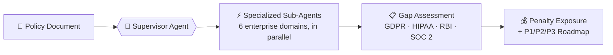
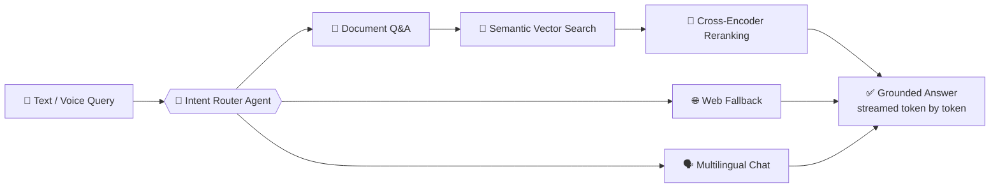
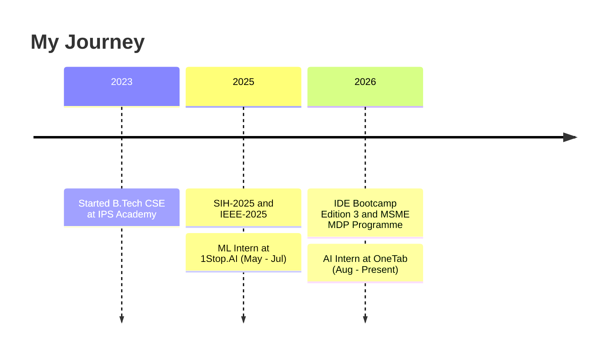

<div align="center">


<br/>

[](https://www.linkedin.com/in/yash-vaswani-04365b301/?isSelfProfile=true)
[](mailto:Yashvaswani2106@gmail.com)
[](mailto:Yashvaswani2106@gmail.com)


</div>

<br/>

## 👋 About Me

```text
> I build AI systems that go beyond chatbots:
  agentic RAG pipelines, multi-agent workflows and real-time voice agents.
```

| | |
|---|---|
| 🔭 **Now** | AI Intern at **OneTab**, building agentic RAG, tag-based retrieval and voice agents |
| 🎓 **Education** | B.Tech CSE at **IPS Academy, Indore** (CGPA 8.75) |
| 🌱 **Exploring** | Production-grade GenAI, multi-agent orchestration, retrieval quality |
| 🏆 **Activities** | SIH-2025 • IEEE-2025 • IDE Bootcamp Edition 3 • MSME MDP Programme |
| 💬 **Ask me about** | RAG, LLM agents, NLP, Python |

<br/>

## 🛠️ Tech Stack

<div align="center">


<br/>


<br/><br/>


</div>

<br/>

## 🚀 Featured Projects

### 🛡️ LexMesh: Autonomous Compliance Intelligence Platform
Audits corporate policies against **EU GDPR, US HIPAA, RBI Cyber Security Framework and AICPA SOC 2** in under 30 seconds.



- Findings are grounded with **verbatim clause citations**, and missing clauses are flagged instead of guessed
- Statutory financial exposure engine (GDPR Art. 83, HIPAA civil penalties)
- Executive-ready audit exports


<br/>

### 🎙️ Multimodal RAG & Voice Agent Platform
Enterprise-grade document intelligence with voice interaction.



- Multimodal ingestion: scanned PDFs, charts, tables and audio
- Multi-provider failover, token-level streaming and semantic caching
- Context sanitizers and schema validators to keep answers grounded


<br/>

### 📄 AI-Based Plagiarism Detection System
Flask web app that detects plagiarism in `.txt`, `.docx` and `.pdf` files, with NLP preprocessing (tokenization, stopword removal, lemmatization), TF-IDF and cosine similarity at document and sentence level. Backed by SQLite and deployed on Google Cloud Platform.


<br/>

### 📌 Project Repositories

<div align="center">

<a href="https://github.com/YashVaswani/LexMesh"></a>
<a href="https://github.com/YashVaswani/Intellect-RAG"></a>
<a href="https://github.com/YashVaswani/Plagiarism-Detection-System"></a>

</div>

<br/>

## 💼 Experience



| Role | Company | What I do |
|---|---|---|
| **AI Intern** | OneTab · Aug 2026 – Present | Agentic RAG, tag-based retrieval, multi-agent workflows, voice agents |
| **ML Intern** | 1Stop.AI · May – Jul 2025 | Regression and classification models, NLP, EDA, feature engineering |

<br/>

## 📊 GitHub Stats

<div align="center">


</div>

<br/>

<div align="center">

### 📫 Let's build something together
**Yashvaswani2106@gmail.com**


</div>
